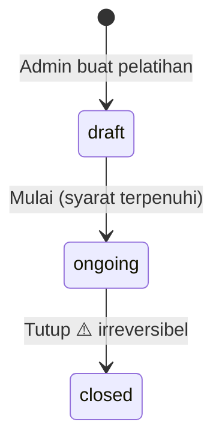

# 06 — Business Process
Pemilik alur. Peran: `docs/05_USER_ROLE.md`. Data: `docs/07_DATA_MODEL.md`.

## A. Siklus pelatihan (status)

**Syarat draft → ongoing** (`StartTrainingAction`; gagal → daftar alasan ditampilkan):
1. ≥ 1 peserta terdaftar, ≥ 1 materi.
2. Setiap materi punya narasumber dan Σ JP sesinya = JP materi.
3. Setiap sesi berada di rentang `start_date`–`end_date` pelatihan.

## B. Impor peserta (F2)
1. Admin mengunggah `.xlsx` sesuai template (unduh dari halaman impor; kolom: `docs/07_DATA_MODEL.md` tabel `users`).
2. Job `ImportParticipantsJob` memproses tiap baris: NIP divalidasi (18 digit angka) → user dengan NIP itu dipakai ulang, atau dibuat baru (`role=peserta`, password awal = NIP, `must_change_password=true`) → didaftarkan ke pelatihan.
3. Ringkasan (total/berhasil/gagal + alasan per baris) tersimpan di `imports` dan tampil di layar.

Cabang gagal: NIP kosong/format salah, NIP duplikat dalam berkas, NIP milik user berperan non-peserta, atau peserta sudah terdaftar → baris dilewati + alasan dicatat. Baris valid tetap diproses (bukan all-or-nothing). Berkas bukan xlsx/header salah → seluruh impor ditolak sebelum masuk queue.

## C. Presensi (F4)
1. Admin/narasumber membuka sesi (status pelatihan `ongoing`) → grid peserta × status.
2. Tombol "Tandai semua hadir" lalu koreksi per baris → Simpan (upsert per peserta-sesi).

Cabang: pelatihan bukan `ongoing` → hanya baca. Narasumber membuka sesi materi lain → 403. Peserta tanpa baris presensi dihitung *tidak hadir*.

## D. Tugas (F6)
Narasumber membuat tugas (tenggat) → peserta mengunggah (boleh mengganti selama sebelum tenggat & belum dinilai) → narasumber memberi nilai + umpan balik. Lewat tenggat → unggah ditolak.

## E. Pre/post-test (F7)
1. Admin menyusun soal (≥ 1, tepat satu opsi benar per soal) dan mengatur jendela pre & post + durasi.
2. Peserta menekan Mulai di dalam jendela → `test_attempts` dibuat (`started_at`) → jawaban tersimpan per soal.
3. Kumpulkan, atau waktu habis (`started_at + durasi`) → nilai dihitung di server.

Cabang: di luar jendela → tombol nonaktif. Percobaan kedua → ditolak. Waktu habis tanpa kumpul → dinilai otomatis dari jawaban tersimpan, saat halaman dibuka lagi atau oleh scheduler `tests:finalize-expired` tiap menit. Post-test tidak mensyaratkan pre-test.

## F. Penutupan & sertifikat (F8)
1. Admin membuka **Pratinjau kelulusan**: per peserta → JP hadir, %, pre, post, hasil sementara.
2. Admin menekan **Tutup pelatihan** → dialog konfirmasi (ketik kode pelatihan).
3. `CloseTrainingAction` (dalam transaksi): bekukan nilai di `enrollments`, set `result`, status `closed`, `closed_at/closed_by`.
4. Job `IssueCertificatesJob`: per peserta lulus → nomor dari pola + kode verifikasi → PDF disimpan.
5. QR pada PDF → `/verifikasi/{verification_code}` (publik): nama, NIP tersamar, pelatihan, total JP, tanggal, status **Valid**/**Dicabut**.

Cabang: peserta belum post-test → post = 0 → `failed`. Job sertifikat gagal sebagian → retry per peserta; status penerbitan tampil di daftar sertifikat. Cabut sertifikat → wajib alasan; halaman verifikasi menampilkan *Dicabut*.

## G. Laporan (F9)
Admin memilih pelatihan → Ekspor Excel (sheet: Kehadiran, Nilai Tes, Tugas, Kelulusan) atau PDF rekap kelulusan. Sebelum ditutup, laporan berlabel "SEMENTARA".
